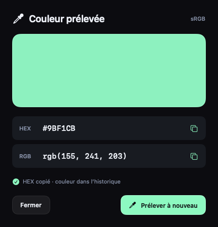

# EasyPaste

Un gestionnaire de presse-papiers natif pour macOS, gratuit et sous licence MIT. Interface en français, couleurs graphite, menthe et lavande. SwiftUI pour l’interface, AppKit pour le presse-papiers et les fenêtres.

## Installation

1. Ouvrir `dist/EasyPaste-0.3.1-universal.dmg`.
2. Glisser EasyPaste dans Applications, puis l’ouvrir.
3. Cliquer sur **Activer l’historique**. Les prochaines copies seront enregistrées.
4. Depuis une autre application, ouvrir la barre rapide avec **Maj + Commande + V**.
5. Choisir une carte, puis appuyer sur **Entrée**. Pour le collage direct, autoriser EasyPaste dans **Réglages → Général → Collage**. Sans cette autorisation, la sélection est copiée et peut être collée avec **Commande + V**.

macOS 15 ou ultérieur. L’installateur universel contient les exécutables Apple Silicon et Intel. La fermeture de la bibliothèque laisse l’app disponible dans la barre des menus. Utiliser **Quitter EasyPaste** pour l’arrêter.

## Mises à jour et réglages

Depuis la version 0.3.0, choisir **Rechercher des mises à jour…** dans le menu
EasyPaste ou dans **Réglages → Mises à jour**. Sparkle télécharge la version
signée et notarisée depuis GitHub, puis propose **Installer et relancer**.
Les vérifications automatiques sont facultatives. L’historique est conservé.
Les utilisateurs d’une version 0.2.x doivent installer une dernière fois le DMG.

Les réglages sont regroupés en quatre onglets : Général, Confidentialité,
Intégrations et Mises à jour. Dans **Général → Sons**, deux interrupteurs
permettent de régler séparément le tic de copie et le son de capture d’image
ou de texte OCR. Ils sont silencieux pendant un enregistrement vidéo.

La procédure de publication est documentée dans [docs/UPDATES.md](docs/UPDATES.md).

## Fonctions disponibles

- Historique de textes, liens, couleurs, images, vidéos enregistrées et références de fichiers. Déduplication des copies identiques.
- Barre rapide centrée au bas de l’écran actif et bibliothèque avec vues détaillée et compacte.
- Recherche par mots, sans distinction d’accents, dans le texte, les titres, les applications sources et le texte reconnu dans les images. Filtres par type, application, collection et date du jour.
- Favoris et collections permanentes. Suppression au choix, individuelle ou multiple, avec bouton Annuler et restauration depuis la corbeille pendant 7 jours. Suppression définitive possible pour les seuls éléments choisis, après confirmation. Les fichiers d’origine restent intacts.
- Sélection multiple avec Commande ou Maj. Plusieurs textes sont regroupés avec des sauts de ligne ; plusieurs fichiers ou images conservent leurs éléments de presse-papiers.
- Copier, coller directement, coller en texte brut et glisser-déposer. Le glissement d’une carte regroupant plusieurs fichiers porte sur le premier fichier ; la copie conserve l’ensemble.
- Éditeur de texte enrichi avec gras, italique, souligné, barré et annulation native pendant l’édition. Création de textes favoris.
- Aperçu et formatage local de JSON, SQL, CSV et XML. Tableau CSV modifiable, coloration du code et structure XML repliable.
- Reconnaissance du Markdown, aperçu natif avec titres, listes, liens, citations, code et tableaux, édition du source et export `.md`.
- Aperçu SVG statique contrôlé, édition du source et copie/export PNG sans perte. Les fichiers SVG utilisent cet aperçu, les autres fichiers Quick Look.
- Pipette dans le menu de la barre macOS : sélection d’une couleur, copie HEX/RGB et ajout à l’historique.
- Aperçu des images et du texte, ouverture des liens dans le navigateur par défaut.
- Reconnaissance de texte locale avec Vision, en français et en anglais. Le texte reconnu devient recherchable et copiable.
- Pile de collage : collecte ordonnée, retrait des doublons, inversion et copie du prochain élément. Le raccourci de pile prépare le prochain élément ; Commande + V le colle. EasyPaste n’intercepte pas chaque Commande + V.
- Collecte en pause, exclusions d’applications, durée de conservation et ouverture à la connexion.
- Connecteur MCP local, désactivé par défaut, limité aux collections explicitement autorisées.

## Formater JSON, SQL, CSV et XML

1. Copier le texte. Un badge indique le format probable sur sa carte.
2. Sélectionner la carte, puis choisir **Formater…** ou appuyer sur **Espace**. Pour un texte non reconnu, utiliser **Formater…** dans le menu de la carte et choisir le format.
3. Choisir la présentation : **Original**, **Formaté**, **Compact** pour JSON, **Tableau** pour CSV ou **Structure** pour XML.
4. Utiliser **Modifier** pour éditer le texte ou, dans le tableau CSV, double-cliquer sur une cellule. Choisir **Terminer** pour appliquer la mise en forme. **Commande + F** ouvre la recherche.
5. Choisir **Copier le JSON**, **Copier le SQL**, **Copier le CSV** ou **Copier le XML** pour copier la présentation affichée. Le menu **Enregistrer** propose une copie dans l’historique, le remplacement de l’original après confirmation ou l’export d’un fichier.

La présentation seule ne modifie pas l’historique. Le double-clic sur une carte colle toujours son contenu enregistré. La copie créée apparaît à côté de l’original. Le remplacement conserve le titre, la date, les favoris et les collections ; le contenu devient du texte brut.

Le formatage JSON préserve les grands nombres, les échappements, l’ordre et les clés répétées. CSV conserve les valeurs comme `00123`, les cellules entre guillemets et les retours à la ligne internes. Les séparateurs proposés sont la virgule, le point-virgule, la tabulation et la barre verticale. La recherche dans le tableau ne retire aucune ligne de la copie ni de l’export.

Le formatage SQL conserve la casse, les commentaires et les chaînes. Le sélecteur propose Standard, PostgreSQL, MySQL, SQLite et SQL Server. Il signale les blocs, chaînes et parenthèses non fermés, mais ne valide pas toute la grammaire SQL et n’exécute aucune requête.

XML conserve les attributs, les entités écrites, les blocs CDATA, les espaces existants et le contenu mixte. Les déclarations DTD restent accessibles dans **Original** ; leur formatage est désactivé. Aucune entité externe n’est chargée. Cliquer sur une erreur avec un numéro de ligne sélectionne cette ligne dans l’aperçu.

Les calculs se font sur le Mac, en arrière-plan. Les limites protègent la réactivité : entrée de formatage de 4 Mio, résultat de 8 Mio et imbrication de 128 niveaux. Le texte affiché et sa recherche sont limités à 128 Kio ; la coloration porte sur les 64 premiers Kio. La copie et l’export conservent le résultat complet. Le tableau accepte 256 colonnes et 200 000 cellules, avec un affichage à la demande ; les cellules de plus de 16 Kio sont abrégées et non modifiables dans le tableau. La structure XML présente au maximum 2 000 balises.

## Prélever une couleur

1. Cliquer sur l’icône EasyPaste dans la barre des menus, puis sur **Prélever une couleur…**.
2. Déplacer la loupe macOS sur la couleur voulue, sur l’un des écrans, puis cliquer. **Échap** annule sans toucher au presse-papiers.
3. La couleur est ajoutée à l’historique et son code HEX est copié. La fenêtre affiche la teinte, le HEX et le RGB en sRGB.
4. Cliquer n’importe où sur la ligne HEX ou RGB pour copier cette valeur, ou sur **Prélever à nouveau** pour choisir une autre couleur.



## Afficher un SVG

Copier le code SVG ou un fichier `.svg`, puis ouvrir son aperçu. Pour du code non reconnu, choisir **SVG** dans **Formater…**. La vue propose un fond damier, clair ou sombre, **Copier le PNG** et **Exporter le PNG…**. Le PNG conserve la transparence et utilise le profil sRGB ; son grand côté est limité à 2 048 pixels. Le SVG reconstruit reste vectoriel.

Le source copié reste conservé dans l’historique. Les vues **Source** et **Aperçu** utilisent un document reconstruit à partir d’éléments statiques autorisés : formes, tracés, texte, dégradés et découpes. **Modifier** ouvre le code ; **Terminer** le vérifie avant d’afficher le résultat. Le bouton **Copier le SVG** fournit ce document reconstruit. La copie ordinaire et le glisser-déposer depuis une carte SVG passent par les mêmes contrôles.

Les scripts, attributs d’événement, ressources externes ou embarquées, DTD, entités personnalisées, HTML, animations, filtres, `<use>` et feuilles de style sont refusés. Certaines déclarations simples de style en ligne sont acceptées puis converties en attributs. Un fichier non pris en charge affiche une erreur et son source reste accessible. Les SVGZ doivent être décompressés au préalable.

L’analyse est limitée à 512 Kio, 2 000 éléments et 32 niveaux. Le rendu se fait dans un processus séparé, avec un délai de six secondes et arrêt forcé s’il ne répond plus. Il ne s’agit pas d’un navigateur ni d’une sandbox système. La copie ou l’export depuis **Original** demande confirmation, car un autre lecteur peut exécuter le contenu original. L’ouverture explicite d’un fichier externe reste confiée à l’application choisie par macOS.

## Afficher et modifier le Markdown

1. Copier du Markdown. Une carte reconnue porte le badge **Markdown**.
2. Sélectionner la carte et appuyer sur **Espace**, ou choisir **Formater…**. Pour un texte non reconnu, choisir **Markdown** dans le sélecteur de format.
3. Passer entre **Original**, **Source** et **Aperçu**. L’aperçu rend les titres, le gras, l’italique, le texte barré, les listes imbriquées, les cases à cocher, les citations, les liens, les blocs de code et les tableaux.
4. Choisir **Modifier** pour éditer le source, puis **Terminer** pour retrouver l’aperçu. **Commande + F** recherche dans la vue affichée.
5. Utiliser **Copier le Markdown**, **Créer une copie**, **Remplacer l’original…** ou **Exporter le fichier…**. L’export propose l’extension `.md`.

Le source est conservé exactement, y compris les espaces et les retours à la ligne. Un marqueur incomplet reste généralement affiché comme du texte ; il ne bloque pas la copie. La lecture du Markdown utilise Foundation, en arrière-plan. Aucun navigateur n’est chargé : le HTML est affiché comme du texte, et les images sont représentées par leur description. Les liens HTTP, HTTPS et mailto s’ouvrent uniquement après un clic.

L’aperçu traite au maximum les 128 premiers Kio, 1 000 blocs, 4 000 segments de style et 32 colonnes par tableau. Une mention signale un aperçu abrégé. La copie, l’export et l’enregistrement conservent le source complet ; l’édition reste limitée à 128 Kio. Le Markdown n’est pas converti en HTML ou en texte enrichi lors de la copie.

## Capturer et annoter

Le menu près de l’heure propose **Capturer une zone** directement. Le sous-menu **Capture** donne accès aux fenêtres, à l’écran entier, à l’OCR et à la vidéo. Le bouton **Capturer** reste disponible dans la bibliothèque et la barre rapide.

1. Choisir **Capturer une zone**, puis tracer un rectangle à la souris. Appuyer sur **Échap** pour annuler.
2. Retrouver la capture dans la barre rapide. L’image est aussi copiée, prête à coller avec **Commande + V**.
3. Survoler sa carte et cliquer sur le crayon pour ouvrir l’éditeur.
4. Ajouter une flèche, un cadre, du texte ou un surlignage. **Masquer** recouvre les informations avec un rectangle opaque. **Recadrer** conserve la zone choisie.
5. Choisir **Créer une copie** ou **Remplacer l’originale**, puis valider. Une copie apparaît à côté de l’originale. Le remplacement conserve la même carte, son titre, sa date, ses favoris et ses collections, et recalcule le texte reconnu. L’option **Copier dans le presse-papiers** permet aussi de copier l’image obtenue.

Les captures sont enregistrées en PNG sans perte, à la densité native de l’écran. Une zone de 600 × 400 points sur un écran Retina produit 1 200 × 800 pixels. Les miniatures servent à l’affichage ; la copie conserve tous les pixels de l’original. Dans **Aperçu**, **100 %** affiche un pixel de l’image pour un pixel de l’écran, avec défilement si nécessaire. **Ajuster** montre l’ensemble sans agrandir artificiellement une petite image. Les images sont limitées à 50 mégapixels et à 20 Mo encodés.

Pour extraire du texte visible, choisir **Extraire le texte d’une zone**, puis encadrer les lignes voulues. Le texte reconnu est enregistré et copié. La reconnaissance utilise Vision sur le Mac.

## Enregistrer une vidéo

1. Choisir **Capturer → Enregistrer une vidéo…**.
2. Choisir une zone ou l’écran entier. Activer le microphone, la webcam en incrustation et le son de l’ordinateur selon le besoin. Les menus **Source** permettent de choisir les périphériques.
3. Cliquer sur **Choisir la zone** et tracer le rectangle, ou sur **Démarrer dans 3 s** pour l’écran entier. Le cadre reste visible pendant le décompte et l’enregistrement.
4. Cliquer sur **Arrêter** dans la barre flottante, ou utiliser **Contrôle + Option + Commande + S**. Les commandes près de l’heure restent disponibles. Le menu webcam de la barre flottante déplace l’incrustation dans l’un des quatre coins.
5. Ouvrir la carte vidéo, puis utiliser **Lire/Pause** et la barre de position. Choisir **Copier** ou **Enregistrer…** pour exporter le fichier MP4.

La vidéo utilise H.264 à 30 images/s au maximum. La qualité **Native · jusqu’à 4K**, activée par défaut, conserve la densité de l’écran jusqu’à 3 840 pixels sur le grand côté. Le mode **Légère · 1080p** limite le grand côté à 1 920 pixels. Les proportions de la zone sont conservées. La sélection doit tenir sur un seul écran. Prévoir au moins 2,5 Go d’espace libre. L’enregistrement s’arrête vers 800 Mo ou lorsque l’espace disponible descend sous 1,1 Go ; l’import accepte jusqu’à 1 Go. La webcam utilise une vignette 4:3 et nécessite une zone d’au moins 240 × 180 points.

La copie vidéo fournit un fichier MP4 aux applications compatibles. Le collage dans un champ de texte simple ne peut pas y insérer une vidéo. Cette version ne comporte pas d’éditeur de montage vidéo.

macOS demande l’autorisation d’enregistrer l’écran à la première capture. Le microphone et la webcam possèdent chacun une autorisation distincte, demandée uniquement lorsque l’option correspondante est choisie. Si macOS exige de quitter l’app, la rouvrir depuis Applications.

## Raccourcis

| Action | Raccourci |
| --- | --- |
| Ouvrir la barre rapide | Maj + Commande + V |
| Naviguer dans la barre | Flèche gauche / droite |
| Coller la sélection | Entrée |
| Coller en texte brut | Maj + Entrée |
| Coller une des neuf premières cartes | Commande + 1 à 9 |
| Collage rapide en texte brut | Maj + Commande + 1 à 9 |
| Rechercher | Commande + F |
| Modifier un texte ou annoter une image | Commande + E |
| Capturer une zone | Contrôle + Option + Commande + C |
| Extraire le texte d’une zone | Contrôle + Option + Commande + X |
| Arrêter la vidéo | Contrôle + Option + Commande + S |
| Aperçu | Commande + Y |
| Ouvrir un lien ou fichier | Commande + O |
| Créer un texte | Commande + N |
| Créer une collection | Maj + Commande + N |
| Pause / reprise dans EasyPaste | Commande + T |
| Préparer l’élément suivant de la pile | Contrôle + Option + Commande + V |
| Supprimer les cartes sélectionnées (hors champ de texte) | Retour arrière |
| Annuler la dernière suppression (hors champ de texte) | Commande + Z |
| Fermer la barre | Échap |

Les numéros de collage rapide utilisent les touches physiques de la rangée numérique, y compris sur un clavier AZERTY. Les raccourcis globaux sont fixes dans cette version. En cas de conflit avec une autre application, ouvrir la barre depuis le menu EasyPaste.

## Données et confidentialité

La collecte est désactivée au premier lancement. Elle observe les changements du presse-papiers toutes les 650 ms lorsqu’elle est active ; des copies extrêmement rapprochées peuvent donc ne pas toutes être conservées.

Les enregistrements sont chiffrés individuellement avec AES-GCM dans `~/Library/Application Support/EasyPaste/Vault`. La clé est conservée dans le trousseau macOS, accessible sur ce Mac uniquement. Les écritures sont atomiques ; le répertoire utilise les droits 0700 et les fichiers 0600. Une erreur de chiffrement ou d’écriture met la collecte en pause et affiche un message.

Les vidéos sont chiffrées par blocs de 1 Mo, sans charger le fichier entier en mémoire. La lecture et la copie créent un fichier temporaire déchiffré, accessible uniquement à l’utilisateur. Les copies temporaires de plus de 24 heures sont supprimées au lancement suivant. Un enregistrement en cours reste dans `~/Library/Application Support/EasyPaste/Recordings` ; il est supprimé après son import chiffré. Si l’import échoue après finalisation, ce fichier permet une récupération.

Les types de presse-papiers marqués confidentiels, temporaires ou générés automatiquement sont ignorés. Plusieurs gestionnaires de mots de passe sont exclus par défaut. Une extension de navigateur qui ne marque pas un secret peut cependant le laisser enregistrer : utiliser la pause ou exclure le navigateur dans ce cas.

L’app ne transmet aucune copie à un serveur. Elle ne télécharge pas d’aperçus de liens. L’ouverture volontaire d’un lien utilise le navigateur de l’utilisateur. Les références de fichiers pointent vers leur emplacement original ; EasyPaste ne sauvegarde pas leur contenu.

La conservation est de 30 jours par défaut, réglable à 1 jour, 7 jours, 1 an ou toujours. Favoris et collections sont exemptés. Au-delà de 1 Go de contenu original, la collecte se met en pause ; une copie est limitée à 20 Mo. Le chiffrement et l’encodage ajoutent de l’espace disque. Conserver une sauvegarde du Mac incluant les données et le trousseau : cette version n’offre pas de sauvegarde portable ni de restauration intégrée.

## Connecteur MCP

Installer l’app dans Applications. Dans **Réglages → Un lien avec tes assistants**, activer le connecteur puis autoriser les collections voulues. Copier la configuration depuis ce même écran.

```json
{
  "mcpServers": {
    "easypaste": {
      "command": "/Applications/EasyPaste.app/Contents/MacOS/EasyPaste",
      "args": ["--mcp"]
    }
  }
}
```

Le client MCP lance le processus et communique par entrée/sortie standard. Aucun service réseau ni serveur distant n’est nécessaire. Les outils sont en lecture seule : `list_collections`, `search_clips` et `read_clip`. Ils n’accèdent ni à l’historique privé ni à la corbeille, et ne transmettent pas les données binaires des images ou fichiers. Les textes et chemins présents dans une collection partagée deviennent lisibles par l’assistant connecté. Désactiver le connecteur ou retirer une collection révoque cet accès pour les requêtes suivantes.

## Fluidité

- Lecture initiale et chiffrement hors du fil de l’interface.
- Contenus complets relus à la demande ; seuls textes, métadonnées et miniatures restent dans l’interface.
- Miniatures limitées à 640 pixels et cache d’images plafonné à 32 Mo.
- Aperçu ajusté décodé en arrière-plan selon la densité de l’écran (600 pixels en 1×, 1 200 en 2× au maximum). Le mode 100 % décode l’original à la demande et le libère au retour à Ajuster.
- Recadrage direct des pixels ; conservation du profil couleur RGB pendant l’annotation. Assemblage des captures en arrière-plan, sans interpolation des pixels entre écrans 1× et 2×.
- OCR en arrière-plan, avec image de travail réduite à 2600 pixels.
- Encodage vidéo sur une file dédiée, avec une seule image conservée pour les périodes sans mouvement. Les commandes et le cadre sont exclus de la vidéo ; la webcam choisie est incluse.
- Quand les deux sources audio sont activées, le mixage porte uniquement sur le son. Les images H.264 sont assemblées sans deuxième encodage vidéo.
- Recherche différée de 140 ms pendant la frappe, annulable, calculée en arrière-plan.
- Grilles et barre paresseuses ; bibliothèque paginée par groupes de 80 cartes.
- Dates relatives statiques pendant l’affichage, sans actualisation de chaque carte toutes les secondes.

Le test synthétique de recherche sur 10 000 notes prend environ 40 ms sur le Mac de développement en compilation de débogage. Ce chiffre ne mesure pas le temps de chargement d’une photothèque ni les images par seconde de l’interface.

## Développement

Nécessite Xcode avec le SDK macOS et Swift 6. Aucune dépendance externe.

```sh
swift test
./scripts/build.sh
open dist/EasyPaste.app
```

Pour inspecter l’interface avec des données fictives et sans collecter le presse-papiers :

```sh
open -n dist/EasyPaste.app --args --demo
```

Quitter auparavant l’autre instance d’EasyPaste. Le mode démo utilise un dossier temporaire et une clé éphémère, puis supprime ses données à la fermeture normale.

Pour créer un installateur signé et notarisé avec ses propres identifiants :

```sh
CODE_SIGN_IDENTITY='Developer ID Application: Votre équipe (TEAMID)' \
NOTARY_PROFILE='VotreProfilDansLeTrousseau' \
./scripts/package.sh
```

Aucun certificat privé ni identifiant Apple n’est inclus dans le projet. Le script produit le DMG, une archive de l’app, une archive des sources et leurs empreintes SHA-256 dans `dist/`.

## Vérification de la version 0.2

Le 17 octobre 2026, les 26 tests automatisés passent. Ils couvrent le chiffrement, la corruption, les mauvaises clés, les formats, les exclusions, la recherche, l’OCR, la rétention, la suppression et le contrôle d’accès MCP. Les tests ajoutés couvrent les dimensions Retina, les annotations, les copies adjacentes, la sélection, les vidéos chiffrées et un import MP4 réel. Un test reproduit la taille de fichier périmée dans le cache macOS. Le lecteur natif est également instancié trois fois dans le test d’intégration.

Les essais réels de capture comprennent une zone Retina, l’OCR, les annotations et des enregistrements vidéo avec ou sans audio. Le lecteur natif a été rouvert trois fois après correction du retour vers la bibliothèque. L’export MP4 conserve les mêmes octets que le fichier de lecture, sans recompression.

Les contrôles visuels portent sur la bibliothèque, la barre rapide, la recherche sans accents, la sélection, l’édition enrichie, le retour à la ligne et la suppression avec annulation. L’essai utilise un historique fictif distinct des données personnelles. Le collage automatique dans une autre application reste à vérifier après l’autorisation Accessibilité ; le chemin de copie est testé dans un presse-papiers de test isolé.

Le premier appel à Vision peut prendre davantage de temps pendant l’initialisation du moteur Apple. L’interface reste disponible et indique « Lecture du texte… » pendant l’analyse.

## Périmètre de la version 0.2

EasyPaste est une application indépendante, inspirée des usages de Paste, avec son propre code et son propre design. Elle n’intègre pas la synchronisation iCloud, les apps iPhone/iPad, les collections collaboratives, les suggestions Apple Intelligence, un navigateur de liens intégré, la rotation d’images, les raccourcis personnalisables ou le masquage automatique pendant un partage d’écran.

Les pistes fonctionnelles ont été comparées à la documentation officielle de [Paste](https://pasteapp.io/help). Aucun code ni visuel de Paste n’est réutilisé.

## Illustration

L’illustration décorative originale a été créée avec l’outil imagegen intégré. Elle reste disponible dans les sources ; la bibliothèque 0.2.4 donne désormais cette place aux copies. Le fichier source est `Sources/EasyPaste/Resources/clipboard-studio.png` ; le prompt de création figure dans [ASSET-PROMPT.txt](ASSET-PROMPT.txt). Les commandes et les textes restent des composants natifs.

## Licence

[MIT](LICENSE). Gratuit, modifiable et redistribuable selon cette licence. La signature Apple du binaire distribué n’accorde aucun accès aux clés privées de signature.

Les contrôles de netteté, de copie et de réactivité de la version 0.2.2 sont détaillés dans [QA-0.2.2.md](QA-0.2.2.md).

Les corrections vidéo, les commandes flottantes, la webcam et le remplacement des images de la version 0.2.3 sont décrits dans [QA-0.2.3.md](QA-0.2.3.md).

La refonte de la bibliothèque et de l’annotation de la version 0.2.4 est décrite dans [QA-0.2.4.md](QA-0.2.4.md).

La simplification des textes de la version 0.2.5 est décrite dans [QA-0.2.5.md](QA-0.2.5.md).

Le formatage JSON, SQL, CSV et XML de la version 0.2.6 est décrit dans [QA-0.2.6.md](QA-0.2.6.md).
Le rendu Markdown de la version 0.2.7 est décrit dans [QA-0.2.7.md](QA-0.2.7.md).

Le rendu SVG et la pipette de la version 0.2.8 sont décrits dans [QA-0.2.8.md](QA-0.2.8.md).

## Partage Bitwarden · 0.2.9

Intégration native facultative, désactivée par défaut dans Réglages → Intégrations.
Menu dédié, liens publics ou réservés à des adresses e-mail, mot de passe facultatif,
et copie automatique du lien après envoi. L’option « Lien public uniquement »
crée immédiatement un lien de 7 jours avec la date et l’heure en titre.
« Partager avec options… » reste disponible. Aucun CLI à installer.

[Utilisation, confidentialité et limites](docs/bitwarden.md) · [Validation](QA-0.2.9.md).

La version 0.2.10 ajoute les en-têtes de version exigés à la connexion et distingue
les refus de compatibilité, d’identifiants et de limitation des tentatives.
Voir [la validation du correctif](QA-0.2.10.md).

La version 0.2.11 utilise uniquement `bitwarden.com` pour les nouvelles connexions ;
le choix du serveur a été retiré de la fenêtre. [Validation](QA-0.2.11.md).
Connexion et envoi réels avec un compte utilisateur restent à valider ; les tests
automatisés utilisent des serveurs simulés et ne transmettent aucun historique.

Le code original reste MIT ; Argon2 embarqué utilise CC0 1.0.
Voir les [mentions des composants tiers](THIRD-PARTY-NOTICES.md).
