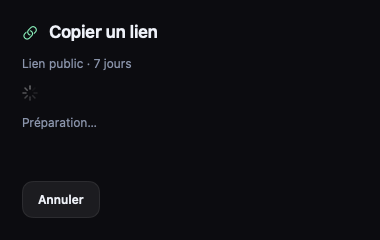
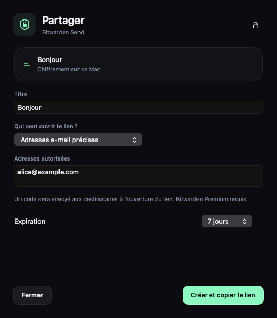

# Partage Bitwarden dans EasyPaste

## Utilisation

Dans **Réglages → Intégrations**, activer **Bitwarden**, puis connecter le compte
sur le bon serveur : Europe (`bitwarden.eu`) ou International (`bitwarden.com`).
La fonctionnalité est désactivée par défaut. Aucun menu Bitwarden, accès au
trousseau ou trafic réseau Bitwarden n’est déclenché tant qu’elle reste désactivée.

Dans le menu contextuel d’une carte, choisir **Bitwarden → Créer un lien…**.
Le menu de la barre de menus propose aussi le partage de l’élément sélectionné,
**Mes partages**, le compte et le verrouillage.

Le formulaire propose un titre, une durée de 1, 3, 7, 14 ou 30 jours, et :

- Toute personne disposant du lien, avec un mot de passe facultatif.
- Des adresses e-mail précises : Bitwarden vérifie l’adresse du destinataire par
  un code envoyé à l’ouverture du lien. Les adresses sont communiquées à Bitwarden
  pour ce contrôle d’accès. EasyPaste n’envoie pas le lien par e-mail.

Le lien est copié après confirmation du serveur et, pour un fichier, après la fin
de l’envoi. Un échec conserve le presse-papiers précédent. Une URL Send contient
la clé de déchiffrement dans son fragment : la copie est marquée confidentielle
afin qu’EasyPaste ne la collecte pas automatiquement dans son propre historique.

### Mode rapide

Cocher **Lien public uniquement** dans les réglages Bitwarden. **Copier un lien**
crée alors immédiatement un lien public de 7 jours, sans mot de passe, avec la
date et l’heure en titre. Une confirmation discrète signale la copie. L’action
**Partager avec options…** reste disponible et ne change pas ce réglage.
Une connexion ou un déverrouillage reste nécessaire si la session est verrouillée.

### Compte, limites et compatibilité

Connexion native par mot de passe maître ; PBKDF2 et Argon2id sont pris en charge.
Les codes d’application d’authentification, d’e-mail et de vérification d’un nouvel
appareil ont des parcours dédiés. SSO, passkeys, clés FIDO, CAPTCHA intégré,
serveurs auto-hébergés et formats de clé autres que AES-CBC-HMAC type 2 ne sont
pas pris en charge. Un message explicite est affiché lorsque le serveur exige
une méthode incompatible. Se connecter dans l’application officielle ne transfère
pas sa session à EasyPaste et ne garantit pas la levée d’un CAPTCHA.

Bitwarden autorise les textes sur les comptes gratuits. Les fichiers et l’accès
par e-mail nécessitent un abonnement compatible. Le serveur fait autorité sur
ces droits. Une adresse de compte non vérifiée ou une règle d’organisation peut
également empêcher le partage.

La limite de texte Bitwarden s’applique au texte **chiffré** (1 000 caractères).
Au-delà de 650 octets UTF-8, EasyPaste prépare donc un fichier `Texte.txt`, indiqué
dans le formulaire, soumis aux conditions des envois de fichiers. Les images sont
envoyées avec leurs octets d’origine ; aucune recompression ou miniature n’est
utilisée. Un fichier ou une vidéo est limité à 500 Mio. Les dossiers, liens
symboliques et sélections de plusieurs fichiers sont refusés.

## Session et sécurité

- L’option n’accorde pas un accès limité aux seuls Sends côté serveur : la session
  est celle d’un client Bitwarden et la clé utilisateur est nécessaire au protocole.
  Le code EasyPaste ne demande ni `/sync`, ni `/ciphers`, ni le contenu du coffre.
- Le mot de passe maître n’est jamais sauvegardé. La connexion envoie le hash
  d’authentification prévu par le protocole et déchiffre la clé utilisateur localement.
- Le jeton de renouvellement et la clé utilisateur sont conservés dans le trousseau
  de connexion de macOS, sans synchronisation iCloud. L’ACL par défaut limite leur
  lecture silencieuse à l’application signée qui les a créés ; macOS demande une
  autorisation pour un autre processus. Le jeton d’accès reste uniquement en mémoire.
  Cette distribution Developer ID n’a pas de profil autorisant le trousseau Data
  Protection : elle utilise donc le trousseau classique, déjà utilisé par l’app.
- EasyPaste exige séparément une validation LocalAuthentication (Touch ID ou
  authentification du Mac) avant de restaurer la session. Ce verrou est appliqué
  par l’application ; ce n’est pas un attribut `userPresence` du trousseau classique.
  Les secrets sont retirés de l’état actif après 15 minutes sans opération, à la
  mise en veille, au verrouillage du Mac ou à une demande de verrouillage.
  Swift et les bibliothèques système peuvent conserver des copies en mémoire :
  cette version ne revendique pas d’effacement mémoire intégral garanti.
- Désactiver le module annule l’opération, masque ses menus et efface sa connexion
  locale. Cela ne révoque pas les liens déjà publiés sur Bitwarden.
- Chaque Send utilise un secret aléatoire de 128 bits et les formats Bitwarden :
  HKDF-SHA256 (`bitwarden-send` / `send`), AES-256-CBC et HMAC-SHA256. Le secret du
  lien n’est pas envoyé en clair au serveur ; sa copie de gestion est chiffrée
  avec la clé utilisateur.
- Les sessions HTTP sont éphémères, sans cache ni cookies. Les redirections sont
  refusées. Le bearer token reste sur l’hôte API Bitwarden sélectionné. Le stockage
  Azure reçoit uniquement les octets chiffrés via son URL HTTPS signée.
- Les réponses sont limitées à 2 Mio. Les KDF sont bornées et exécutées en série
  hors du thread principal. Les fichiers sont chiffrés par blocs de 1 Mio.
- Les préparations temporaires sont dans un dossier privé (0700, fichiers 0600).
  Pour les images et les textes longs, ce dossier contient une copie locale en
  clair avant chiffrement. Il est supprimé à la fermeture, au verrouillage ou à la
  fin du partage. Une fermeture forcée du processus peut laisser ces fichiers
  temporaires jusqu’au nettoyage système. Les vidéos utilisent le cache de lecture
  existant d’EasyPaste, dont la durée est documentée dans les réglages.
- Aucun contenu, mot de passe, jeton, URL signée ou corps de réponse n’est journalisé.

Un envoi de fichier interrompu tente de supprimer sa réservation distante. Si
cette suppression échoue, le message demande de vérifier **Mes partages**. Une
coupure pendant la création peut laisser un partage créé sans confirmation :
EasyPaste ne relance jamais cette création automatiquement pour éviter les doublons.

## Compatibilité du protocole

L’API publique d’administration Bitwarden ne couvre pas ce besoin. La Vault
Management API documentée repose sur `bw serve`. Cette intégration utilise les
points d’accès de leurs clients, sans embarquer la CLI ni le SDK interne, dont
l’interface est annoncée comme instable et non prise en charge pour des tiers.
Une évolution du protocole peut nécessiter une mise à jour d’EasyPaste.

Depuis la version 0.2.10, les requêtes incluent `Bitwarden-Client-Name` et
`Bitwarden-Client-Version`, également exigés lors de la connexion. EasyPaste
annonce sa propre version ; il ne se fait pas passer pour une version officielle
compatible avec des formats de chiffrement non implémentés. Un compte exigeant
le chiffrement V2 reste refusé avec un message de compatibilité explicite.
Les erreurs de protocole ne sont plus présentées comme un mauvais mot de passe.
Les réponses inconnues affichent seulement leur statut HTTP, sans corps de réponse.

Les régions ont des comptes distincts. Pour retrouver celle d'un compte, consulter
l'adresse du coffre habituel : `vault.bitwarden.eu` ou `vault.bitwarden.com`.
EasyPaste ne tente jamais une connexion sur l'autre région automatiquement.

Références primaires consultées le 19 octobre 2026 :

- https://bitwarden.com/help/bitwarden-apis/
- https://bitwarden.com/help/create-send/
- https://bitwarden.com/help/send-encryption/
- https://bitwarden.com/help/kdf-algorithms/
- https://github.com/bitwarden/sdk-internal/tree/main/crates/bitwarden-send
- https://github.com/bitwarden/sdk-internal/tree/main/crates/bitwarden-crypto
- https://github.com/bitwarden/clients/tree/main/libs/common/src/auth
- https://github.com/bitwarden/server/blob/main/src/Api/Tools/Controllers/SendsController.cs
- https://developer.apple.com/documentation/technotes/tn3137-on-mac-keychains
- https://developer.apple.com/documentation/localauthentication/lacontext
- https://github.com/bitwarden/server/blob/main/src/Identity/IdentityServer/RequestValidators/ClientVersionValidator.cs
- https://github.com/bitwarden/server/blob/main/src/Identity/IdentityServer/RequestValidators/BaseRequestValidator.cs

Les tests de compatibilité et leurs limites sont détaillés dans `QA-0.2.9.md`.
